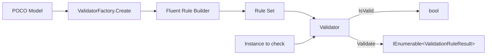

<div align="center">

# DynamicVNET

**Fluent, declarative validation for .NET — composed at runtime, not baked into your models.**

[](https://www.nuget.org/packages/DynamicVNET/)
[](https://www.nuget.org/packages/DynamicVNET/)
[](LICENSE)
[](DynamicVNET.Lib/DynamicVNET.Lib.csproj)

[Quick Start](#quick-start) · [Examples](#examples) · [Method Reference](#validation-method-reference) · [NuGet Package](https://www.nuget.org/packages/DynamicVNET/)

</div>

---

## Overview

DynamicVNET lets you describe *how* a POCO should be validated through a **Fluent API**, then compiles that description into an executable validator at runtime. No attributes on your models required — internally, it wraps the same `System.ComponentModel.DataAnnotations` engine .NET already ships with, so behavior stays familiar while the authoring model stays flexible.

Reach for it when:

- **The model isn't yours to decorate** — it lives in a third-party or black-box `.dll`.
- **One type needs several rule sets** depending on context, e.g. `Create` vs. `Update`.
- **Validation is a domain concern**, not something that belongs baked into a data class.
- **Rules depend on other state on the object** — conditional, branching validation.

DynamicVNET has shipped over **18,000 downloads** on NuGet.

## Highlights

| | |
|---|---|
| **Fluent API** | Chainable, expression-based rules: `builder.Required(x => x.Email).EmailAddress()`. |
| **Branching** | Scope rules to a condition, and nest conditions inside conditions. |
| **Nested members** | Validate deep paths like `x => x.Token.TokenNumber` transparently. |
| **Duplicate-safe** | Registering the same rule for the same member twice is a no-op. |
| **Strongly-typed validators** | Derive from `BaseValidator<T>` for a reusable, injectable validator class. |
| **Fail-fast or collect-all** | Stop at the first failure, or gather every one. |
| **Validation profiles** | Register multiple named rule sets for one type via `ProfileValidator`. |
| **Escape hatch** | Arbitrary `Func<T, bool>` logic via `Predicate` when built-ins fall short. |
| **Structured results** | `Validate()` returns per-rule detail, not just a boolean. |

## Installation

```powershell
# Package Manager Console
Install-Package DynamicVNET -Version 1.4.1
```

```bash
# .NET CLI
dotnet add package DynamicVNET --version 1.4.1
```

```xml
<!-- PackageReference -->
<PackageReference Include="DynamicVNET" Version="1.4.1" />
```

Targets **.NET 5.0**, **.NET Standard 2.0**, and **.NET Framework 4.6.1** — usable from modern and legacy projects alike.

## Quick Start



The models used throughout this document:

```csharp
public class Employee
{
    public string Name { get; set; }
    public Token TokenNumber { get; set; }
    public string Email { get; set; }
}

public class Token
{
    public string Number { get; set; }
}
```

A validator, built and run in a few lines:

```csharp
Employee emp = new Employee
{
    Name = "Jhon",
    TokenNumber = new Token { Number = "2312412312341" },
    Email = "jhon.sim@gmail.com"
};

var validator = ValidatorFactory.Create<Employee>(builder =>
{
    builder.StringLen(x => x.Name, 4)
           .EmailAddress(x => x.Email)
           .Required(x => x.TokenNumber.Number);
});

bool isValid = validator.IsValid(emp);
```

## Examples

Each example below is self-contained and builds on the `Employee` / `Token` models above.

### Focused member chains

Focus a member once with `.For(...)`, then stack rules against it without repeating the selector.

```csharp
var validator = ValidatorFactory.Create<Employee>(builder =>
{
    builder.For(x => x.Email)
           .Required()
           .EmailAddress();

    builder.For(x => x.Name)
           .Required()
           .StringLen(50, min: 2);
});
```

### Nested members

Selectors walk into child objects freely, and duplicate registrations are ignored automatically — safe when composing rule sets from multiple sources.

```csharp
var validator = ValidatorFactory.Create<Employee>(builder =>
{
    builder.Required(x => x.TokenNumber.Number)
           .Required(x => x.TokenNumber.Number); // duplicate, silently ignored
});
```

### Conditional rules with `Branch`

Scope a group of rules to a condition evaluated against the instance being validated.

```csharp
var validator = ValidatorFactory.Create<Employee>(builder =>
{
    builder.Branch(x => x.Name.Contains("Jhon"), x =>
    {
        x.MaxLen(m => m.TokenNumber.Number, 15);
    });
});
```

### Nested branches

Branches compose — a condition can enclose further conditions, each with its own rule set.

```csharp
var validator = ValidatorFactory.Create<Employee>(builder =>
{
    builder.Required(x => x.TokenNumber.Number)
           .Branch(x => x.Name.Contains("resul"), x =>
           {
               x.Required(y => y.Email)
                .StringLen(y => y.Email, 2)
                .Branch(n => n.Name.Length >= 4, n =>
                {
                    n.MaxLen(s => s.TokenNumber.Number, length: 4);
                });
           })
           .Branch(x => x.Email.Contains("aa"), x =>
           {
               x.Required(y => y.Name)
                .StringLen(y => y.Name, 5)
                .StringLen(y => y.TokenNumber.Number, 9);
           });
});
```

A failed rule inside a branch surfaces on `NestedResults` of that branch's `ValidationRuleResult`, so you can trace *why* a conditional block failed.

### Custom logic with `Predicate`

Drop to arbitrary logic whenever a built-in rule doesn't fit.

```csharp
var validator = ValidatorFactory.Create<Employee>(builder =>
{
    builder.Predicate(x => x.Email.EndsWith("@company.com"), "Email must be a company address");
});
```

### Numeric comparisons

`Range`, `GreaterThan`, and `LessThan` are overloaded for `int`, `double`, `decimal`, `float`, and `byte`.

```csharp
public class Order
{
    public int Quantity { get; set; }
    public decimal Total { get; set; }
}

var validator = ValidatorFactory.Create<Order>(builder =>
{
    builder.Range(x => x.Quantity, 1, 100)
           .GreaterThan(x => x.Total, 0m, "Total must be a positive amount");
});
```

### Fail-fast validation

By default every rule runs and every failure is collected. Set `failFirst: true` to short-circuit on the first invalid rule — useful for cheap gate checks.

```csharp
var validator = ValidatorFactory.Create<Employee>(builder =>
{
    builder.Required(x => x.Name)
           .Required(x => x.Email)
           .EmailAddress(x => x.Email);
}, failFirst: true);
```

### Strongly-typed validators

For a validator you want to reuse, inject, or unit test in isolation, derive from `BaseValidator<T>`.

```csharp
public class EmployeeValidator : BaseValidator<Employee>
{
    protected override void Configure(ITypeRuleMarker<Employee> builder)
    {
        builder.For(x => x.Name)
               .Required();

        builder.Branch(x => x.Name.Contains("Jhon"), x =>
        {
            x.MaxLen(m => m.TokenNumber.Number, 15);
        })
        .For(x => x.Email)
        .Required()
        .EmailAddress();

        builder.Required(x => x.TokenNumber.Number);
    }
}
```

```csharp
var empValidator = new EmployeeValidator();
bool result = empValidator.IsValid(emp);
```

Override `FailFirst` on the class to opt a whole validator into fail-fast mode:

```csharp
public class FastEmployeeValidator : BaseValidator<Employee>
{
    public override bool FailFirst => true;

    protected override void Configure(ITypeRuleMarker<Employee> builder)
    {
        builder.Required(x => x.Name).Required(x => x.Email);
    }
}
```

### Profile-based validation

Register several named rule sets for the same type and pick one at call time — ideal for `Create` vs. `Update` style scenarios.

```csharp
var profiles = new ProfileValidator();

profiles.AddByProfile<Employee>("Create", builder =>
{
    builder.Required(x => x.Name).Required(x => x.Email);
});

profiles.AddByProfile<Employee>("Update", builder =>
{
    builder.EmailAddress(x => x.Email);
}, failFirst: true);

bool isValidOnCreate = profiles.IsValid("Create", emp);
```

### Inspecting detailed results

`Validate(instance)` returns one `ValidationRuleResult` per evaluated rule.

```csharp
IEnumerable<ValidationRuleResult> results = validator.Validate(emp);

foreach (var result in results.Where(r => !r.IsValid))
{
    Console.WriteLine($"{result.MemberName} failed {result.ValidationName}: {result.ErrorMessage}");
}
```

Each result exposes:

- `MemberName` / `ValidationName` — what was checked, and by which rule.
- `IsValid` — the outcome.
- `ErrorMessage` / `ErrorInfo` — failure detail, as a `ValidationException`.
- `NestedResults` / `HasNestedResults` — failures bubbled up from an inner `Branch`.

## Validation Method Reference

Every method below is available both directly on `ITypeRuleMarker<T>` (`builder.Required(x => x.Email)`) and, after focusing a member with `.For(...)`, as a member-less chain (`builder.For(x => x.Email).Required()`).

| Method | Applies to | Description |
|---|---|---|
| `Required` | any | Ensures the member is non-null / non-empty. |
| `Null` / `NotNull` | reference types | Asserts the member is (or isn't) `null`. |
| `StringLen` | `string` | Validates a string falls within a min/max length. |
| `MaxLen` | `string` | Enforces a maximum length. |
| `RegularExp` | `string` | Validates against an arbitrary regex pattern. |
| `EmailAddress` | `string` | Validates well-formed email addresses. |
| `Url` | `string` | Validates the value is a URL. |
| `Range` | numeric | Validates a value falls within `[min, max]`. |
| `GreaterThan` / `LessThan` | `int`, `double`, `decimal`, `float`, `byte` | Numeric comparisons. |
| `Predicate` | any | Arbitrary custom logic via `Func<T, bool>`. |
| `Branch` | any | Applies a nested rule set only when a condition holds. |

## How It Works

The fluent API records rules onto a `RuleMarker<T>`, which produces an immutable rule set. A `Validator<T>` runs that set against an instance through a pluggable **Applier**:

- `DefaultApplier` executes every rule and collects every result.
- `FailFirstApplier` (used when `failFirst: true`) stops at the first failure.

Straightforward rules — `Required`, `StringLen`, `MaxLen`, `Range`, and the regex-based rules — are adapted directly onto `System.ComponentModel.DataAnnotations` attributes, keeping behavior consistent with the .NET validation ecosystem. `Predicate` and `Branch` exist as the escape hatch for everything attributes can't express.

## Project Layout

```
DynamicVNET.Lib/                    Core library (net5.0 / netstandard2.0 / net461)
DynamicVNET.Lib.Unit.Tests/         xUnit unit tests
DynamicVNET.Lib.Integration.Tests/  xUnit integration tests (end-to-end validator scenarios)
DynamicVNET.Lib.Benchmarks/         BenchmarkDotNet performance benchmarks
```

## Contributing

Issues and pull requests are welcome at [github.com/rasulhsn/DynamicVNET](https://github.com/rasulhsn/DynamicVNET). For a new validation rule or API shape, opening an issue first helps keep the design aligned before you invest time in a PR.

## License

Released under the [MIT License](LICENSE).

---

<div align="center">

[DynamicVNET](https://github.com/rasulhsn/DynamicVNET) · Copyright © 2018–2024 [Rasul Huseynov](https://github.com/rasulhsn)

</div>
